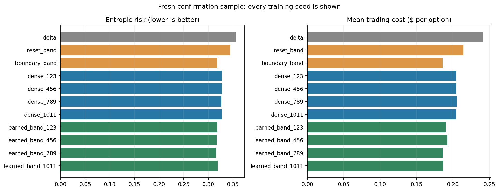

# Deep hedging under transaction costs

A reproducible simulation study of neural hedging for a European call option.
The project compares a direct-action Keras network and a learned no-transaction
band network with delta hedging and two transaction-cost-aware financial rules.

**Research question:** can a neural policy improve the balance between trading
expense and hedging risk, when every strategy is evaluated with the same
entropic risk objective?

The main finding is about financial structure and benchmark quality: a dense
policy improved on a rule that resets to delta, but a stronger rule that trades
only to the band boundary was competitive with the learned approaches. The
learned-band architecture addresses the dense model's tendency to make small,
costly adjustments. See [the results report](RESULTS.md) for the fresh final run,
including every training seed and uncertainty estimates.

## Fresh final result

On 30,000 new paths, the learned-band architecture matched the strong financial
rule; it did not establish a reliable improvement over it.

| Strategy | Entropic risk (lower is better) |
|---|---:|
| Validation-selected boundary rule | 0.31844 |
| Dense network, mean across four seeds | 0.32755 |
| Learned-band network, mean across four seeds | 0.31758 |

All four learned-band-versus-boundary bootstrap intervals included zero. The
architecture closed the dense model's gap with the stronger rule, while the
remaining small numerical difference was unresolved. Neural averages summarize
separate model scores, not an ensemble.



## Start here

Open [hedging.ipynb](hedging.ipynb) for the finance explanation, experiment design,
results, and figures. The notebook reads the bundled results by default, so
"Run All" does not silently launch another full training experiment.

```bash
python3.11 -m venv .venv
source .venv/bin/activate
python -m pip install -r requirements.txt
python -m jupyter lab hedging.ipynb
```

CPU execution is supported; no GPU, paid dataset, API key, or external market
data is required. The package versions above were tested together. Seeds make
the protocol reproducible, but different hardware/framework versions can still
change optimization trajectories and checkpoint selection.

## Reproduce the experiment

Run a short integration check first:

```bash
python -m unittest discover -s tests -v
python run_experiment.py --profile quick --output results/quick
```

The quick profile uses only three epochs and one seed. **Its metrics are not
research results.** The full profile trains both architectures for all four seeds:

```bash
python run_experiment.py --profile full --output results/rerun-01
python export_report.py results/rerun-01
```

Choose a new output folder for each run; completed runs and existing checkpoints
are protected against accidental overwriting. The training loop saves the
validation-selected `.keras` checkpoint and history after each model finishes.
Checkpoints are for inference; optimizer state is not saved for exact training
resumption. Training time depends on hardware. `--threads` controls CPU threads.

To view another completed run, change `RUN_DIR` in the notebook. To train from
the notebook, set `RUN_TRAINING=True` and choose a new `RUN_DIR` first.

## Financial setup

- Sell one cash-settled European call on one share: stock and strike both $100.
- Expiry after 20 trading days; 252 trading days per year.
- Geometric Brownian motion with 20% annualized volatility and zero expected
  stock return; zero interest and dividends.
- Black--Scholes premium consistent with these assumptions: approximately $2.25.
- Daily rebalancing, fractional stock holdings between zero and one share.
- Transaction costs of 0.1% of stock value traded, including the opening hedge
  and terminal liquidation. Cash borrowing is included; interest is zero.

The loss is `log(mean(exp(-gamma * pnl))) / gamma`, evaluated numerically with
log-sum-exp. Risk aversion is fixed at `gamma=1` per dollar. Lower is better;
negative values are valid. Trading costs already enter P&L and are not penalized
twice. This is risk management of an option obligation, not return prediction.

## Experiment design

- 50,000 training paths (seed 101); 10,000 validation paths (seed 202).
- Same training paths for every model; four initialization/shuffle seeds per
  architecture: 123, 456, 789, 1011.
- Up to 100 epochs, Adam, batch size 1,024, gradient clipping, validation-based
  stopping/checkpoint selection with patience 10 and improvement threshold 0.0001.
- Both financial band widths selected on validation paths from a fixed grid.
- 30,000 fresh final paths (seed 909), shared by every strategy. Every model is
  reported; no seed is selected using final performance and no ensemble is implied.
- Paired percentile bootstrap intervals against the boundary rule, 2,000
  resamples. They are individual 95% intervals conditional on each trained
  model and simulator, not multiple-comparison-adjusted claims.
- Additional volatility-misspecification scenarios at 10%, 20%, 30%, and 40%.
  Premium, assumed volatility, network weights, costs and band widths stay fixed.

The final protocol was consolidated after exploratory development. The fresh
sample is independent of the earlier samples used during that development;
this is not a preregistered or real-market study.

## Files

| File | Purpose |
|---|---|
| `hedging.ipynb` | Annotated finance and ML walkthrough, executed results |
| `hedging.py` | Simulator, accounting, policies, training and evaluation |
| `run_experiment.py` | Full/quick experiment entry point |
| `reporting.py` | Figures generated from saved outputs |
| `export_report.py` | Export figures and a Markdown report from a completed run |
| `tests/test_hedging.py` | Financial identities and model integration checks |
| `results/full/` | Fresh results, configuration, checkpoints and figures |
| `results/exploratory/` | Clearly labelled recorded results from the original notebook |
| `RESULTS.md` | Result tables, interpretation and limitations |

## Limits

All results are simulated. The model omits jumps, stochastic volatility, market
impact, spreads that change over time, discrete lot sizes, financing frictions,
and liquidity constraints. Constant-volatility stress scenarios are not tests
of stochastic-volatility dynamics. Neural policies cannot observe realized future
shocks. An unexpected increase in actual volatility can cause an average loss
because the original option premium is insufficient; hedging cannot repair the
pricing shortfall in expectation in this zero-drift setup.

The baseline bands start exactly at delta; neural policies choose their initial
holding. All opening costs are charged, but the initial-position conventions
differ. The financial band search uses a finite grid, not a proof of optimality.
An architecture change therefore does not establish a universal improvement or
isolate only one causal mechanism. Bootstrap intervals do not include training
data uncertainty or simulator misspecification; repeated seeds assess optimizer
variation on one fixed training dataset. Entropic scores can be sensitive to rare
losses and finite Monte Carlo samples, particularly in the higher-volatility tests.

## Research references

- Buehler, Gonon, Teichmann and Wood, [Deep Hedging](https://arxiv.org/abs/1802.03042).
- Imaki et al., [No-Transaction Band Network: A Neural Network Architecture for
  Efficient Deep Hedging](https://arxiv.org/abs/2103.01775).
- [Keras custom TensorFlow training loops](https://keras.io/guides/writing_a_custom_training_loop_in_tensorflow/).

The learned-band model is inspired by the second paper, rather than a complete
reproduction. The simulator, comparisons and implementation choices are described
explicitly so the results can be assessed independently.
